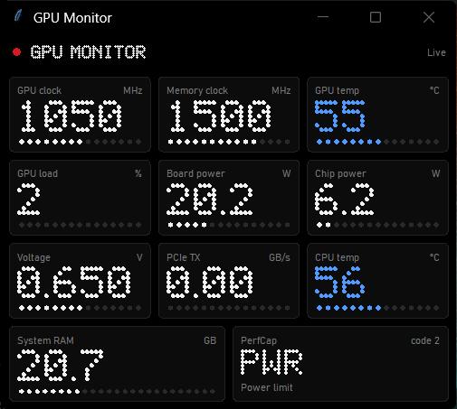
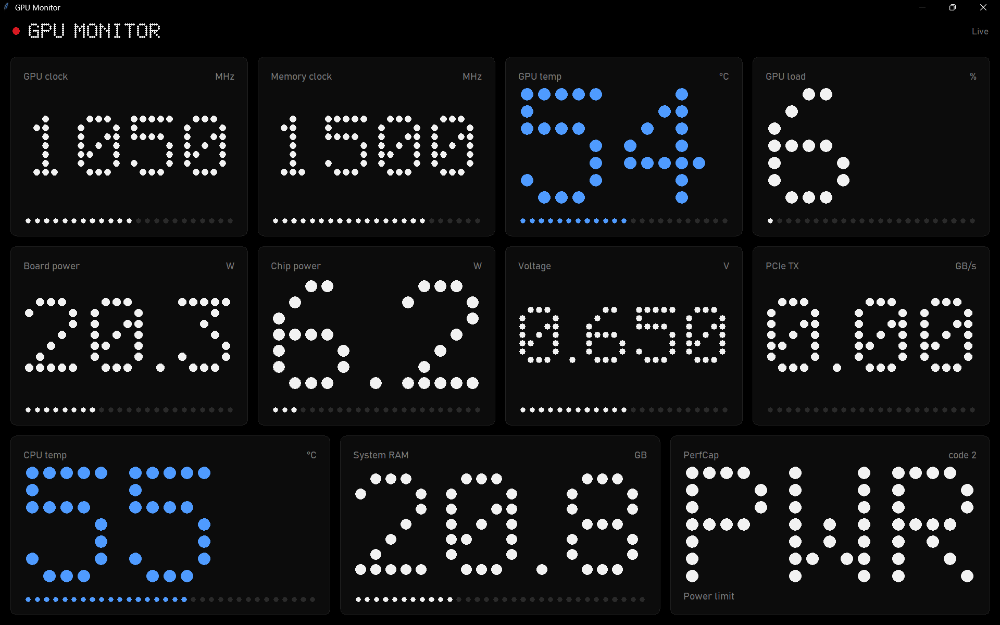

# GPU-Z Nothing Monitor

A lightweight Windows desktop dashboard that turns live GPU-Z sensor readings into a clean, monochrome interface inspired by Nothing OS.

The app reads GPU-Z's shared memory and presents hardware telemetry in a responsive grid of dot-matrix cards. GPU-Z does the sensor detection; this project provides the visual dashboard.

## Screenshot




## Features

- Live readings refreshed every **500 ms**.
- Nothing-inspired black-and-white interface with dot-matrix numbers.
- Resizable window with a tile layout that adapts to the available space.
- GPU and system readings:
  - GPU clock and memory clock
  - GPU temperature and GPU load
  - Board power and GPU chip power
  - GPU voltage and PCIe transmit (TX)
  - CPU temperature and system RAM usage
  - GPU Performance Cap (PerfCap) reason
- Temperature color indicators: blue below 60°C, yellow from 60°C to below 75°C, and red at 75°C or above.
- Optional always-on-top mode and fullscreen mode.
- No third-party Python packages required.

## Requirements

- Windows (the app uses the Windows API to access GPU-Z shared memory).
- Python 3 with Tkinter available.
- [GPU-Z](https://www.techpowerup.com/gpuz/) running in the background.

The available readings depend on the sensors exposed by your GPU, system, and GPU-Z version. A sensor that is unavailable or does not match one of the app's expected names may appear as `-`.

## Run

1. Install Python 3 if it is not already installed. Make sure Tkinter is included.
2. Download or clone this repository.
3. Launch **GPU-Z** and leave it running. It can be minimized.
4. Double-click `gpuz_nothing.pyw`.

If double-clicking does not launch the app, open Command Prompt in the project folder and run:

```bash
pythonw gpuz_nothing.pyw
```

`pythonw` starts the window without opening a separate console window.

## Keyboard shortcuts

| Key | Action |
| --- | --- |
| `T` | Toggle always-on-top |
| `F11` | Toggle fullscreen |
| `Esc` | Exit fullscreen |

## Configuration

A few appearance and behavior settings can be changed near the top of `gpuz_nothing.pyw`:

| Setting | What it changes |
| --- | --- |
| `REFRESH_MS` | Sensor refresh interval in milliseconds (default: `500`) |
| `TOPMOST_AT_START` | Start with the window always on top |
| `GHOST_DOTS` | Show faint, unlit dots behind the dot-matrix numbers |
| `BG`, `CARD`, `EDGE`, `FG`, `DIM`, `FAINT`, `RED`, `BLUE`, `YELLOW` | UI colors |
| `TEMP_BANDS` | Temperature color thresholds |

## Troubleshooting

**The app says `Waiting for GPU-Z`**

Make sure GPU-Z is open and running before or while the dashboard is open. The dashboard reads GPU-Z's shared-memory data; it does not collect sensor data on its own.

**The app says `Connected, no matching sensors` or some cards show `-`**

Check the Sensors tab in GPU-Z and confirm that your hardware exposes the relevant readings. Sensor names and availability can vary between systems. This app currently looks for specific sensor-name prefixes defined in `TILES` near the top of the script.

**The dashboard looks different on my PC**

The available fonts and Windows display scaling can affect the appearance. The app uses Bahnschrift when available and falls back to Segoe UI or the Tk default font.

## Notes

- This is a visual monitoring dashboard, not a benchmark or a logging/export tool.
- PerfCap decoding is best-effort; the raw code is also displayed so it can be checked against GPU-Z.
- This is an independent project and is not affiliated with or endorsed by Nothing or TechPowerUp.

