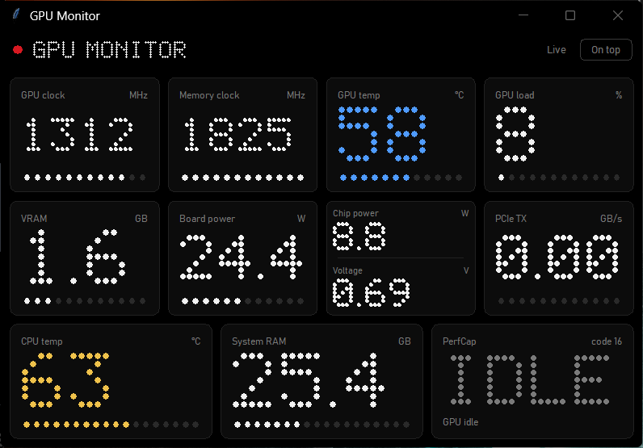
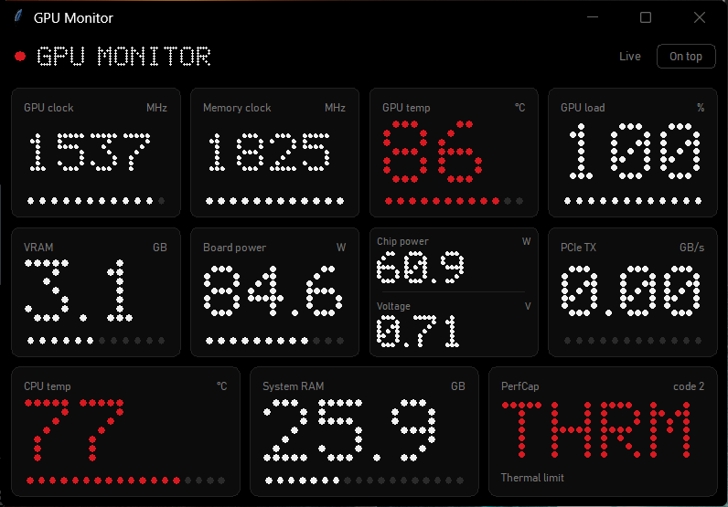

# GPU-Z Nothing Monitor

A lightweight Windows desktop dashboard that turns live GPU-Z sensor readings into a clean, monochrome interface inspired by Nothing OS.

The app reads GPU-Z's shared memory and presents hardware telemetry in a responsive grid of dot-matrix cards. GPU-Z does the sensor detection; this project provides the visual dashboard.

## Screenshot



*At idle.*



*Under load, with a thermal limit (`THRM`) shown in red.*

## Tested on

> **NVIDIA only, for now.** Developed and tested on an NVIDIA GeForce RTX 3060 Laptop GPU with GPU-Z 2.71 on Windows 11.
> AMD and Intel GPUs are **untested**. They expose some sensors under different names, so a few cards may not appear. Any reading GPU-Z doesn't report is simply hidden, and the sensor list is configurable (see [Configuration](#configuration)). Reports from other hardware are welcome.

## Features

- Live readings refreshed every **500 ms**.
- Nothing-inspired black-and-white interface with dot-matrix numbers.
- Resizable window with a tile layout that adapts to the available space. Window size, position and always-on-top are remembered between runs.
- GPU and system readings:
  - GPU clock and memory clock
  - GPU temperature and GPU load
  - VRAM used, with the meter scaled to your card's total VRAM as reported by GPU-Z
  - Board power, plus GPU chip power and GPU voltage in one compact card
  - PCIe transmit (TX)
  - CPU temperature and system RAM usage
  - GPU Performance Cap (PerfCap) reason, with a short plain-language description
- Cards for sensors your system doesn't report are hidden automatically, and the rest re-flow to fill the window.
- Temperature color indicators: blue below 60°C, yellow from 60°C to below 75°C, and red at 75°C or above.
- PerfCap turns red only for a thermal limit; other reasons stay white.
- "On top" button in the header to keep the window above other apps.
- Tiles, thresholds and refresh rate are editable in a JSON config file.
- No third-party Python packages required.

## Requirements

- Windows (the app uses the Windows API to access GPU-Z shared memory).
- [GPU-Z](https://www.techpowerup.com/gpuz/) running in the background. It is a separate program by TechPowerUp and is not included in this project.
- Either the ready-made `.exe` from the Releases page, **or** Python 3 with Tkinter to run the script.

The available readings depend on the sensors exposed by your GPU, system, and GPU-Z version.

## Run

1. Launch **GPU-Z** and leave it running. It can be minimized.
2. Start the dashboard using one of these:

**Option A: the `.exe` (no Python needed)**

Download `GPUZ-Nothing-Monitor.exe` from the Releases page and double-click it.

**Option B: the Python script**

1. Install Python 3 if it is not already installed. Make sure Tkinter is included.
2. Download or clone this repository.
3. Double-click `gpuz_nothing.pyw`.

If double-clicking does not launch the script, open Command Prompt in the project folder and run:

```bash
pythonw gpuz_nothing.pyw
```

`pythonw` starts the window without opening a separate console window.

## Controls

| Input | Action |
| --- | --- |
| `On top` button | Toggle always-on-top (remembered) |
| `T` | Toggle always-on-top |
| `F11` | Toggle fullscreen |
| `Esc` | Exit fullscreen |
| `D` | Save a sensor dump (`gpuz_dump.txt`) and open its folder |

## Configuration

Settings are stored in `%APPDATA%\GPUZ-Nothing-Monitor\`:

| File | Purpose |
| --- | --- |
| `config.json` | Tiles, thresholds and refresh rate. Created with defaults on first run; safe to edit. |
| `state.json` | Window size, position and always-on-top. Managed by the app. |

If `config.json` is missing or broken, the app falls back to the defaults and says so in the header. To reset it, delete the file.

### `config.json` options

| Key | What it changes |
| --- | --- |
| `refresh_ms` | Sensor refresh interval in milliseconds (default: `500`, minimum `100`) |
| `ghost_dots` | Show faint, unlit dots behind the dot-matrix numbers |
| `vram_total_mb` | `null` detects VRAM size from GPU-Z. Set a number (for example `6144`) to override it. |
| `temp_bands` | Temperature color thresholds as `[upper limit, color]` pairs |
| `tiles` | The cards to show, in order |

### Tiles

Each tile maps a card to GPU-Z sensor names. A sensor name is matched as a prefix, and the first one found wins.

```json
{
  "label": "GPU temp",
  "sensors": ["GPU Temperature"],
  "decimals": 0,
  "bands": "temp",
  "meter": { "type": "max", "max": 100 }
}
```

| Field | Values |
| --- | --- |
| `label` | Text shown on the card |
| `sensors` | List of GPU-Z sensor-name prefixes to try |
| `decimals` | Digits after the decimal point |
| `kind` | `number` (default), `memory` (MB shown as GB), or `perfcap` |
| `bands` | `"temp"` colors the value using `temp_bands` |
| `meter` | `{"type": "max", "max": N}` fixed scale; `{"type": "auto", "floor": N}` scales to the session peak; `{"type": "ram"}` system RAM; `{"type": "vram"}` GPU VRAM; or omit for no meter |

Two readings can share one card with `{"pair": [tileA, tileB]}`, as the default chip power and voltage card does. To remove a card, delete its entry. To add one, copy an entry and change the sensor name. The easiest way to find exact names is to press `D` and read the `[sensors]` list in the dump.

Colors, fonts and the always-on-top default can also be changed near the top of `gpuz_nothing.pyw`: `BG`, `CARD`, `EDGE`, `FG`, `DIM`, `FAINT`, `RED`, `BLUE`, `YELLOW`, `UI_FONTS`, `TOPMOST_AT_START`.

### VRAM total

GPU-Z publishes static card info next to the live sensors. The app looks there for the memory size, so the VRAM meter adapts to any card. If it can't find one, the meter scales to the highest usage seen in the session instead. Setting `vram_total_mb` overrides detection.

## PerfCap

PerfCap shows what is currently limiting the GPU's boost clock. A limit showing is normal and is not a fault by itself.

| Shown | Meaning |
| --- | --- |
| `IDLE` | GPU is idle |
| `PWR` | Power limit reached |
| `THRM` | Thermal limit reached (shown in red) |
| `VREL` | Reliability voltage limit |
| `VOP` | Maximum operating voltage reached |

GPU-Z does not document the exact bit layout of this value, so the decoding is best-effort. The raw code is shown on the card so you can check it against GPU-Z.

## Troubleshooting

**The app says `Waiting for GPU-Z`**

Make sure GPU-Z is open and running before or while the dashboard is open. The dashboard reads GPU-Z's shared-memory data; it does not collect sensor data on its own. Also check that both programs run at the same privilege level (both normal, or both as administrator).

**The values stop updating when GPU-Z is minimized**

In GPU-Z's Sensors tab, enable the option to keep refreshing sensors while GPU-Z is in the background.

**The app says `Connected, no matching sensors`, or a card you expect is missing**

Cards are hidden when GPU-Z doesn't report a matching sensor. Check the Sensors tab in GPU-Z to confirm your hardware exposes the reading, then press `D` and look at the `[sensors]` and `[tiles]` sections of the dump. You can point a tile at the right name in `config.json`. If you think it is a bug, open an issue and attach the dump. It contains hardware details such as card name and driver version, so skim it before posting.

**The VRAM meter looks wrong**

Press `D` and check `detected VRAM total` in the dump. If it is empty or wrong, set `vram_total_mb` in `config.json` and open an issue with the dump.

**The window opened off-screen or at a strange size**

Delete `state.json` from `%APPDATA%\GPUZ-Nothing-Monitor\`.

**Windows SmartScreen or antivirus flags the `.exe`**

Unsigned executables built with PyInstaller are sometimes flagged as unknown or as false positives. If you'd rather not run it, use the Python script, or build the `.exe` yourself (below).

**The dashboard looks different on my PC**

The available fonts and Windows display scaling can affect the appearance. The app uses Bahnschrift when available and falls back to Segoe UI or the Tk default font.

## Build the `.exe`

On Windows with Python 3 installed, run `build_exe.bat` from the project folder. It installs PyInstaller and writes `dist\GPUZ-Nothing-Monitor.exe`.

The repository also includes a GitHub Actions workflow (`.github/workflows/build-exe.yml`) that builds the `.exe` on a Windows runner. It runs when you push a version tag such as `v1.0.0` and attaches the `.exe` to the release, or you can start it manually from the Actions tab.

## Notes

- This is a visual monitoring dashboard, not a benchmark or a logging/export tool.
- PerfCap decoding is best-effort; the raw code is also displayed so it can be checked against GPU-Z.
- GPU-Z exposes one GPU at a time, so the dashboard shows the GPU currently selected in GPU-Z.
- This is an independent project and is not affiliated with or endorsed by Nothing or TechPowerUp.

## License

Released under the MIT License. See [LICENSE](LICENSE) for details.
